# Images

## 01 Pdf Ingestion

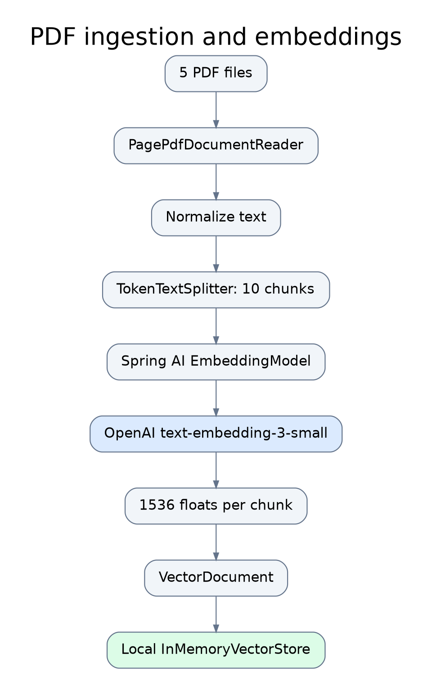

## 02 Semantic Search

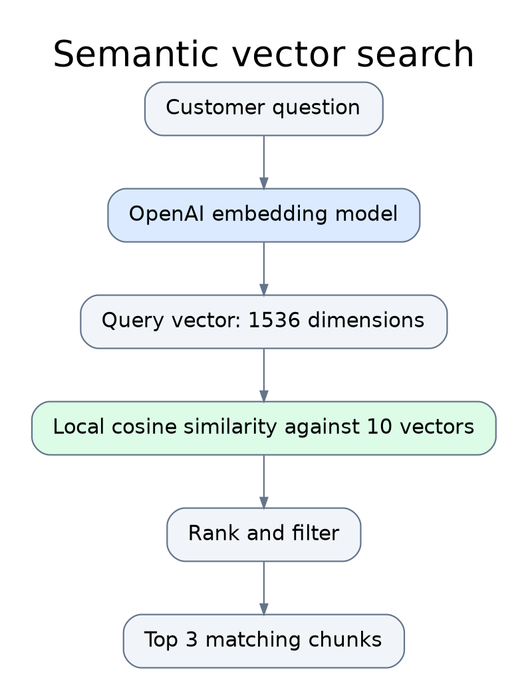

## 03 Rag Architecture

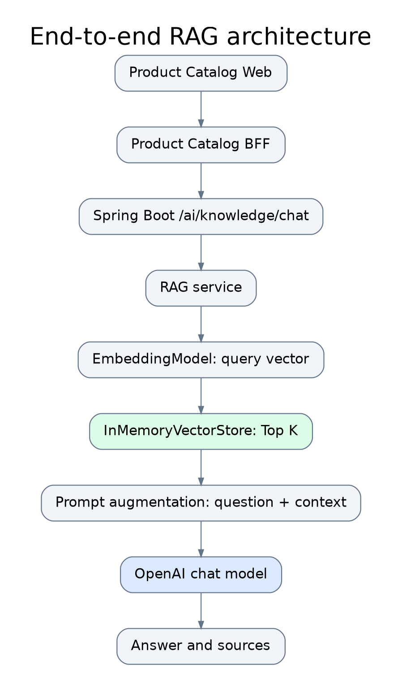

## 04 Postgresql Migration

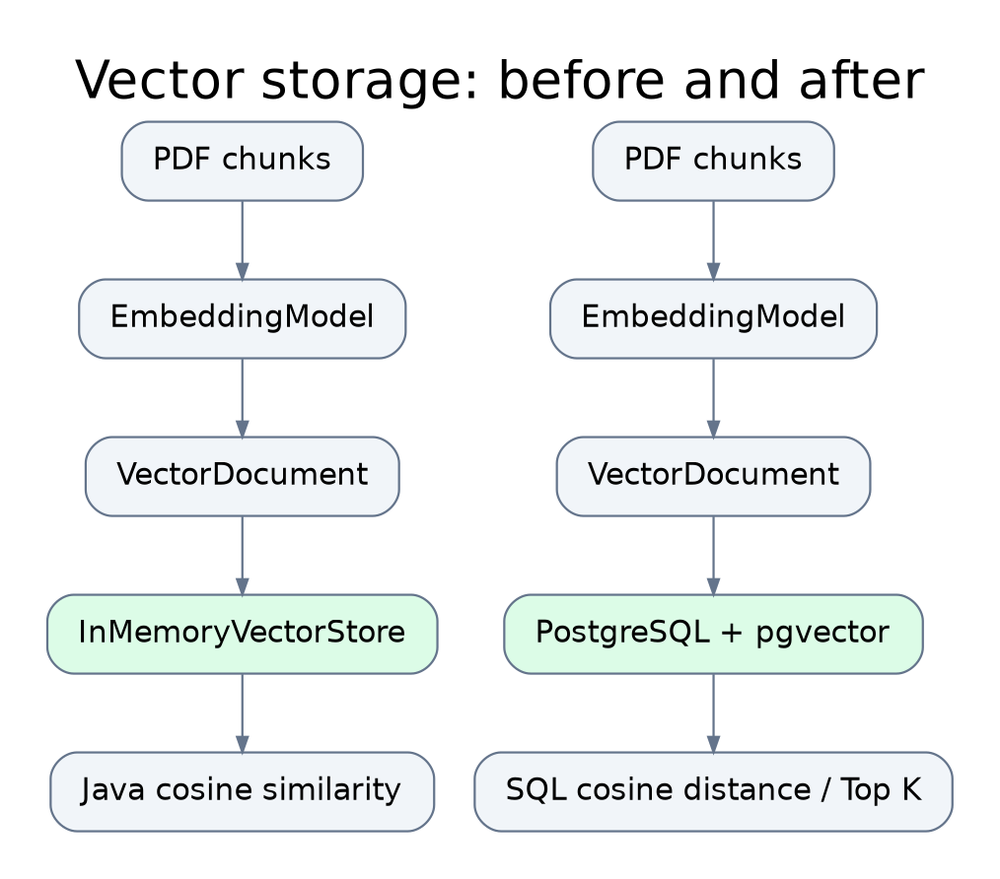

## 05 Local Ollama

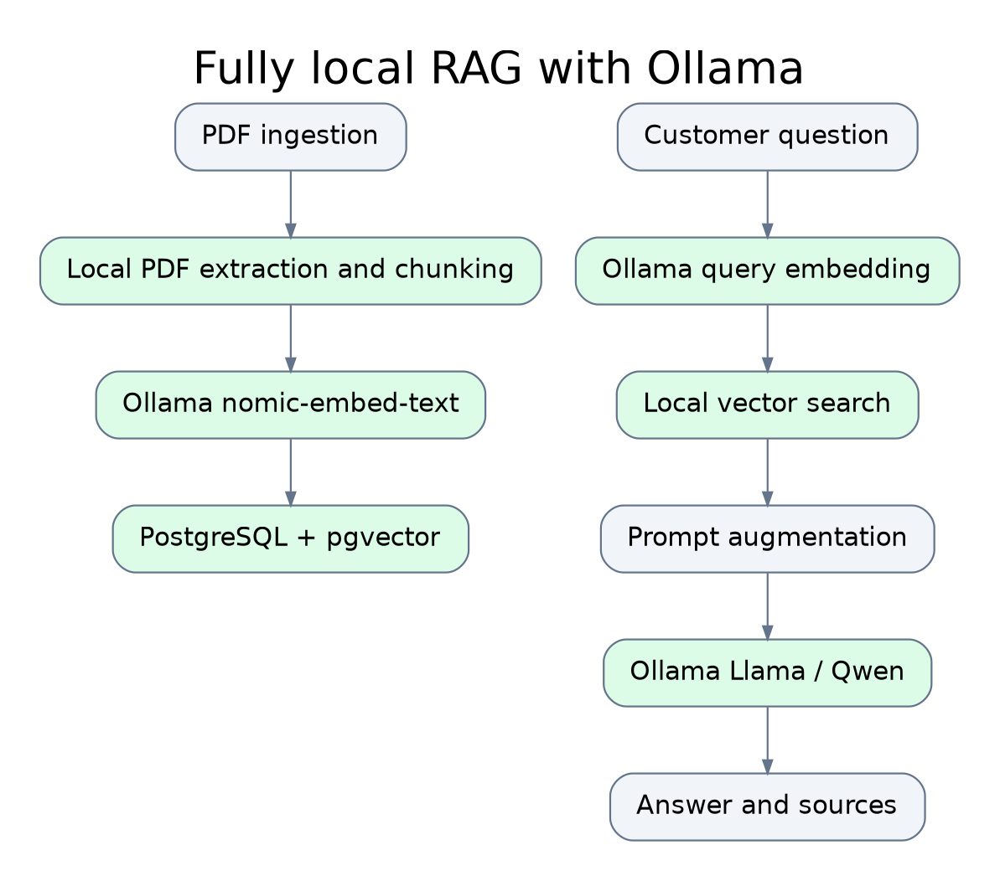

## 06 Fixed Dimensions

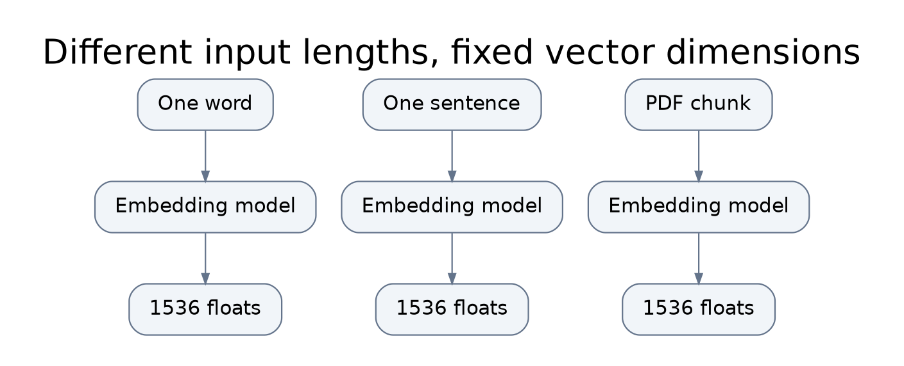

## 07 Vector Dimensions

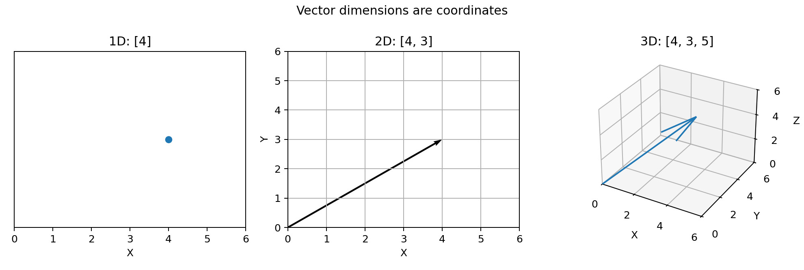

## 08 Cosine Similarity

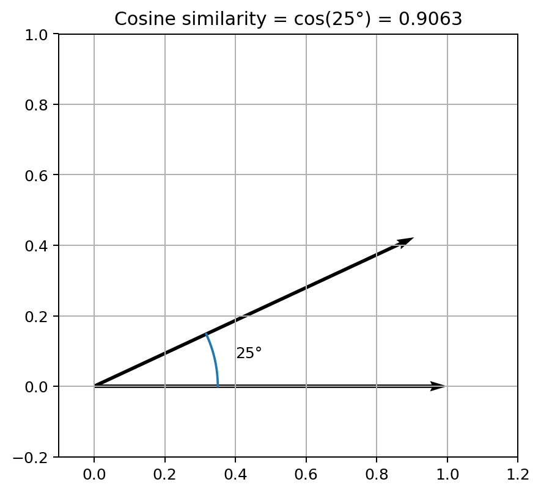

## 09 Embedding Example

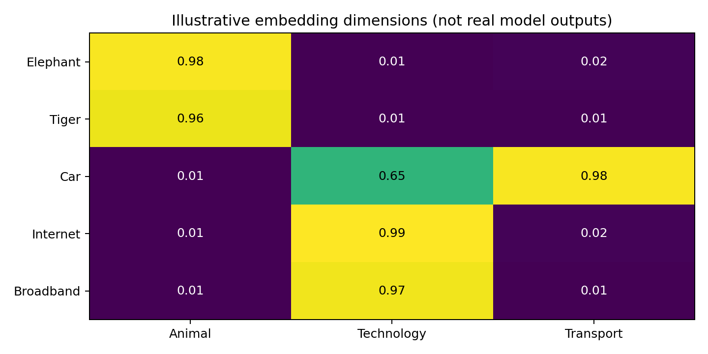

## 10 Search Results

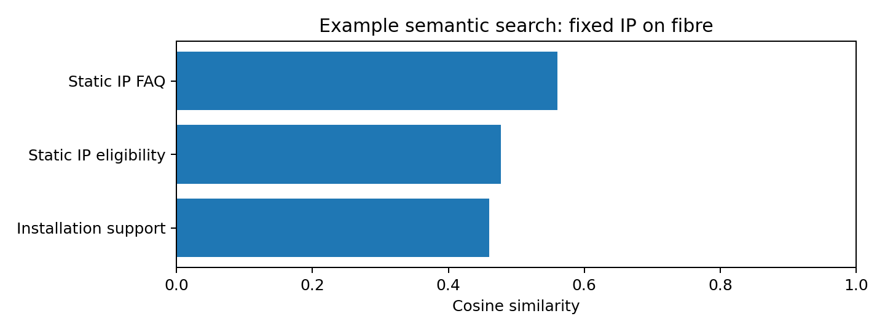

## Knowledge Diagram

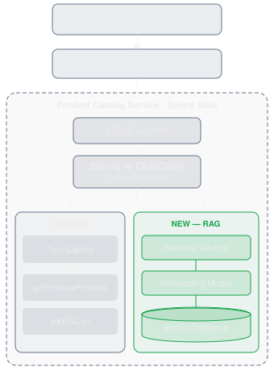
